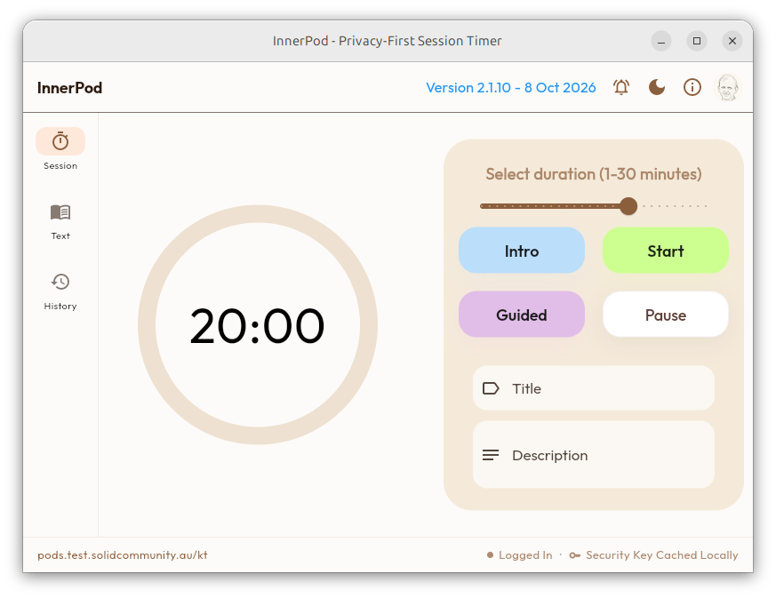
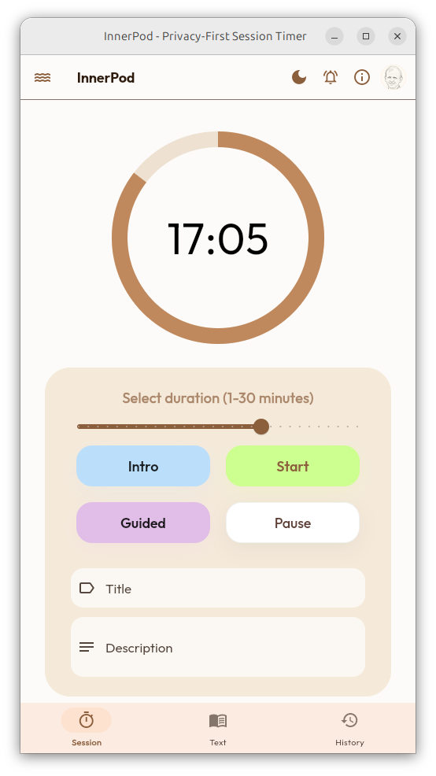
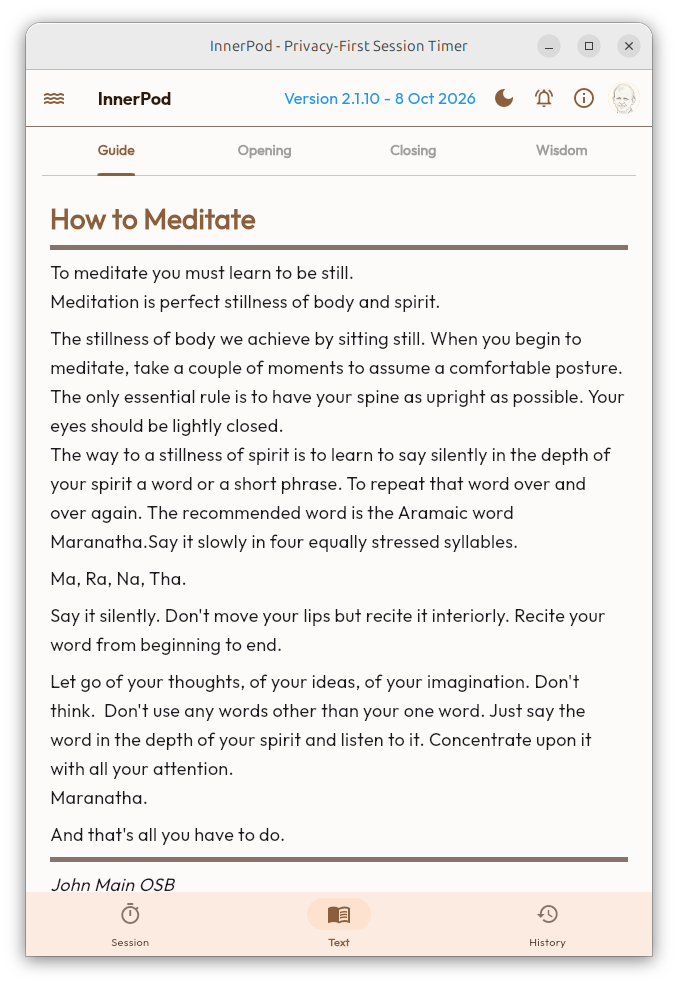
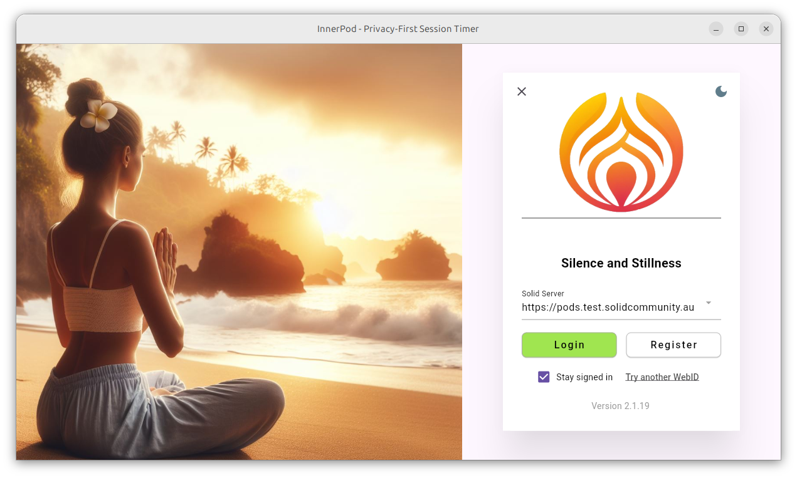

# InnerPod - Privacy-First Session Timer

[![Snap Sore]Get it from the Snap Store](https://img.shields.io/snapcraft/v/innerpod?track=latest&risk=stable)](https://snapcraft.io/innerpod)

[InnerPod](https://gjwgit.github.io/radiopod/) provides a timer for
contemplative and mindfulness meditation sessions, although any kind
of regular timed session is supported. Tap **Start** for a session of
silence to start and end with three bells. Tap **Intro** for a short
audio intro to the session before the bells. Tap **Guided** for
instructions on meditation and then music for before and after the
session.

A history of your sessions is stored locally. Your history can also be
encrypted and privately stored in your own personal online data store
(Pod) of your choice.  In this way your secure and private data is
available on any of your devices where the app is installed.

Pods are an innovation from the inventor of the World Wide Web, Sir
Tim Berners-Lee. Independent of this app you can obtain a Pod for
yourself on any Solid server. On logging in to your Pod for the first
time you will be asked for a security key to protect your app
data. **You do not need a Solid Pod to use this app.**

The app is supported by [Togaware](https://togaware.com) and is
implemented by [Graham
Williams](https://togaware.com/Graham.Williams.html) using
[Flutter](https://flutter.dev)'s
[SolidUI](https://github.com/anusii/solidui) package for cross
platform development.

We make this project available for free so if you appreciate the app
then please show some ❤️ and tap on the star at
[GitHub](https://github.com/gjwgit/radiopod) to support our work. See
the [AU Solid Community](https://solidcommunity.au) **showcase** for
many more apps using the Solid ecosystem.

## Features

+ An audio **Guide** to meditation.
+ A mediation session is begun and concluded with three **Bells**. You
  have a choice of appropriate **Bells**.
+ A **Countdown Timer** defaults to 20 minutes with a choice of any
  time up to 30 minutes.
+ Session **History** with title and notes is recorded. If connected
  to a Solid server the history is securely and privately stored in
  your Pod and can be shared between your app running on any device.
+ **Dark/Light** modes are supported.
+ Runs on **Android, Android Auto, iOS, Apple CarPlay, GNU/Linux,
  macOS, Windows and the web**.

## Privacy

InnerPod is built to protect your privacy. The app maintains a history
of your sessions. In **local** mode (the default) all data remains on
your device. When you **Login** to a Solid server hosting your Pod,
your history is stored in your Pod and is accessible to your app
running on any device through your security key. The security key is
used to decrypt the data on your device so it is not accessible by
anyone on the Solid server. Your Solid server of choice may collect
your login timestamp and other standard server logging of meta data.

## Installation

You can install the released version of the app from different
repositories including:

+ [Google Play
Store](https://play.google.com/store/apps/details?id=com.togaware.innerpod)
for Android;
+ [SnapCraft](https://snapcraft.io/innerpod) for Linux.

The latest version of the app can be run online at
[innerpod.solidcommunity.au](https://innerpod.solidcommunity.au) with
no installation required, or downloaded and installed for your
platform from the [Solid Community AU](https://solidcommunity.au)
repository:

+ **Web**
  [solidcommunity](https://innerpod.solidcommunity.au/);
+ **Android**
  [apk](https://solidcommunity.au/installers/innerpod.apk);
+ **GNU/Linux**
  [snap](https://solidcommunity.au/installers/innerpod_amd64.snap) or
  [deb](https://solidcommunity.au/installers/innerpod_amd64.deb) or
  [zip](https://solidcommunity.au/installers/innerpod-linux.zip);
+ **macOS**
  [dmg](https://solidcommunity.au/installers/innerpod-macos.dmg) or
  [zip](https://solidcommunity.au/installers/innerpod-macos.zip);
+ **Windows**
  [zip](https://solidcommunity.au/installers/innerpod-windows.zip) or
  [exe](https://solidcommunity.au/installers/innerpod-windows-inno.exe).

Contributions are welcome. Visit
[github](https://github.com/gjwgit/innerpod) to submit an issue or,
even better, fork the repository yourself, update the code, and submit
a Pull Request. The app is implemented in
[Flutter](https://flutter.dev). Thanks.

## Using the App

A silent meditation session begins with the sounding of three bells and
finishes with the same bells.

The green **Start** button initiates a 20 minute (the default)
session.Change the duration using the slider.

The blue **Intro** button plays a short opening in preparation
for the meditation.

The purple **Guided** button plays an introductory guide to meditating
following by a short piece of music to prepare yourself for the
meditation session. At the conclusion another short musical interlude
is played as you emerge from the silence. This is commonlyused in a
group meditation session.

The interface is fully adaptive to the screen size and works just as
well on mobile devices.

The **Text** tab presents written material for reading at your own
pace. Included are the **Guide** which explains how to meditate,
**Opening** and **Closing** prayers for the start and end of a
session, and traditional **Wisdom** for reflection.

A login screen is displayed on tapping the Not Logged In text bottom
left of the the top right navigation menu. This allows optional access
for sharing your history securely andprivately through your Solid
Pod. You choose a Solid server of your choice, from free but as-is
servers like [Solid Community AU](https://pods.solidcommunity.au) or
any one of the supported servers. All data is encrypted on the Pod and
only you have access to the data on your device, unless you explicitly
share the data.

## The App Itself

The app is written in
[Flutter](https://survivor.togaware.com/gnulinux/flutter.html) and the
open source code is available from
[github](https://github.com/gjwgit/innerpod). We utilise the
[solidpod](https://pub.dev/packages/solidpod) package for Flutter.

You can try it out online at [Solid Community
AU](https://innerpod.solidcommunity.au). We also welcome testers of
the [Android
app](https://play.google.com/store/apps/details?id=com.togaware.innerpod).

For more information on the Solid project visit the [Solid Project
AU](https://solidproject.org) site.

## Acknowledgements

The app was implemented by [Graham
Williams](https://togaware.com/graham.williams.html) using [Solid Pod
libraries](https://github.com/anusii/solidpod) developed by the ANU's
[Software Innovation Institute](https://sii.anu.edu.au).

The graphics (login page picture and logo/icon) were generated using
Microsoft's
[Designer](https://designer.microsoft.com/image-creator). The audio
was generated using ElevenLabs text to speech.

The instructions for meditating by John Main are from
[WCCM](https://wccm.org).

The bells were generated by Anthropic's Claude.

## Contributing

Feel free to pickup tasks from the list in
[Issues](https://github.com/gjwgit/innerpod/issues) and so create a
fork to work on the issue to then submit a pull request. Or else
contact <innerpod@togaware.com> to volunteer to work directly on the
project.

Time-stamp: <Monday 2026-10-19 07:58:50 +1100 Graham Williams>

<!-- markdownlint-disable MD053 -->
[comment]: # (Local Variables:)
[comment]: # (time-stamp-line-limit: -8)
[comment]: # (End:)
<!-- markdownlint-enable MD053 -->
